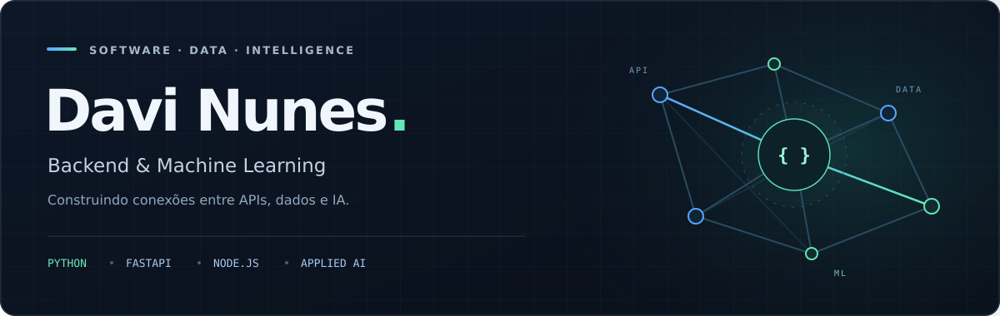
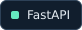
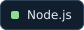
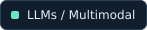
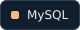
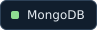
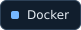

  

  <strong>APIs bem construídas. Dados bem tratados. IA com aplicação prática.</strong>

  <a href="#sobre-mim">Sobre mim</a>
  &nbsp;·&nbsp;
  <a href="#tecnologias">Tecnologias</a>
  &nbsp;·&nbsp;
  <a href="#foco-atual">Foco atual</a>

## Sobre mim

Olá! Sou **Davi Nunes**, desenvolvedor com foco em **backend, machine learning e IA aplicada**, e graduando em **Ciência da Computação no IFG**.

Meu interesse está na conexão entre engenharia de software e dados: construir APIs, integrar serviços e incorporar inteligência às aplicações. Valorizo código claro, fundamentos sólidos e soluções que façam sentido na prática.

- **Backend** — APIs, arquitetura, autenticação e integração entre sistemas.
- **Dados** — SQL, modelagem, preparação e análise de dados.
- **Machine learning & IA** — fundamentos, experimentação, avaliação de modelos e integração com aplicações.

## Tecnologias

**Backend**

  
  
  
  
  

**Machine learning & IA**

  
  
  
  

**Dados & infraestrutura**

  
  
  
  
  
  

## Foco atual

- Aprofundar o desenvolvimento backend com **Python e FastAPI**.
- Fortalecer **SQL, modelagem de dados e arquitetura de software**.
- Explorar **machine learning**, da preparação dos dados à avaliação dos modelos.
- Conectar **IA e APIs** para transformar modelos em funcionalidades úteis.

---

  Engenharia de software, dados e aprendizado contínuo.

